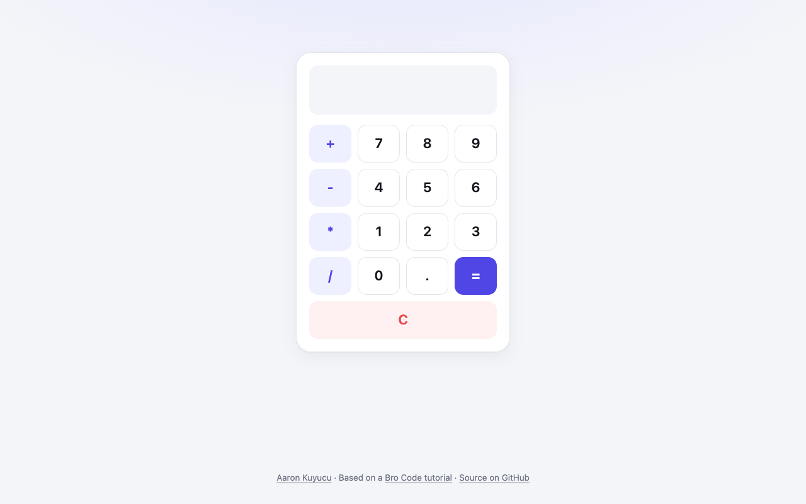

# Calculator

A browser calculator for the four basic operations, usable with the mouse or the keyboard.



## Features

- Addition, subtraction, multiplication and division with the usual precedence (`2+3*4` is 14)
- Decimals and negative numbers (`7*-2`)
- Keyboard input: digits and `+ - * / .` (a comma works as the decimal point too), `Enter` or `=` to calculate, `Backspace` to delete, `Escape` to clear
- Shows "Error" for an incomplete expression (`7+`) and for division by zero
- After a result, a digit starts a new calculation and an operator continues with the result

## Tech

- HTML, CSS (Grid), vanilla JavaScript, no dependencies
- Tests with Node's built-in test runner

## How to run

Open the live version: **[aaronkuy.github.io/calculator](https://aaronkuy.github.io/calculator/)**

Or run it locally. There is no build step and no dependency:

```bash
git clone https://github.com/aaronkuy/calculator.git
cd calculator
open index.html        # macOS; on Linux use xdg-open, on Windows start
```

Run the tests (needs Node.js, no install step; checked with Node 24):

```bash
node --test
```

## How it works

- `calculator.js` has no DOM access. `evaluate()` is a small recursive-descent parser: it splits the expression into numbers and operators and computes the result with `*` and `/` binding tighter than `+` and `-`. Anything that is not a number or one of the four operators is a syntax error. `appendKey()` decides which key presses are accepted while typing (one decimal point per number, a second operator replaces the first).
- `index.js` keeps the expression and a mode (`typing`, `result`, `error`), listens for clicks on the keypad and for key presses, and writes to the display.
- Both are classic scripts loaded with `defer`. ES modules would be blocked when `index.html` is opened from disk.

The first version computed the result with `eval()`. That let JavaScript syntax leak into the calculator: `010+1` was 9 (octal), `5//2` was 5 (a comment), `1/0` was `Infinity`, and `=` on an empty display showed `undefined`. These cases are now tests in `test/calculator.test.js`.

## What I learned

- Laying out a keypad with CSS Grid
- Wiring buttons to a shared display

## Known limitations

- No brackets, percent or memory keys
- No backspace key on the keypad (keyboard only)
- Results are rounded to 12 significant digits; very large results are shown in exponent notation
- The display is a read-only input, so screen readers do not announce a new result on their own

## Credits

The keypad layout and the first version of the display logic follow Bro Code's tutorial
["Build this JS calculator in 15 minutes!"](https://www.youtube.com/watch?v=I5kj-YsmWjM).
The stylesheet is not the tutorial's. The `eval()` call from the tutorial
has since been replaced by the parser described above, and keyboard input and tests were added.

## License

MIT, see [LICENSE](LICENSE). It applies to the changes made in this repository;
the tutorial it started from is credited above.
