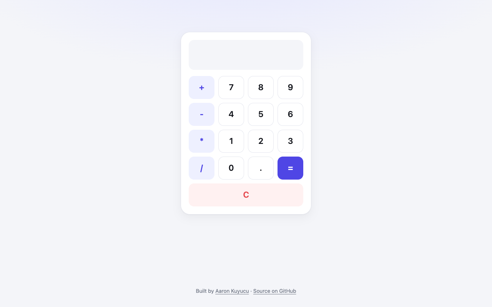

# Calculator

A browser calculator for the four basic operations with a clean button grid.



## Features

- Addition, subtraction, multiplication, division and decimals
- Clear button to reset the display
- Shows "Error" instead of crashing on an invalid expression

## Tech

- HTML, CSS (Grid), vanilla JavaScript

## How to run

Open the live version: **[aaronkuy.github.io/calculator](https://aaronkuy.github.io/calculator/)**

Or run it locally. There is no build step and no dependency:

```bash
git clone https://github.com/aaronkuy/calculator.git
cd calculator
open index.html        # macOS; on Linux use xdg-open, on Windows start
```

## What I learned

- Laying out a keypad with CSS Grid
- Wiring buttons to a shared display input
- Catching errors from expression evaluation with `try`/`catch`

## What I'd do next

- Replace `eval()` with a small expression parser (safer and more predictable)
- Keyboard input
- Show the running expression above the result

## License

See [LICENSE](LICENSE).
